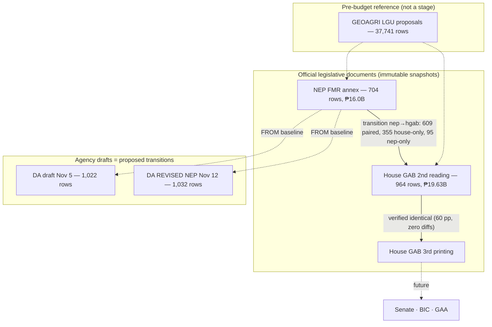
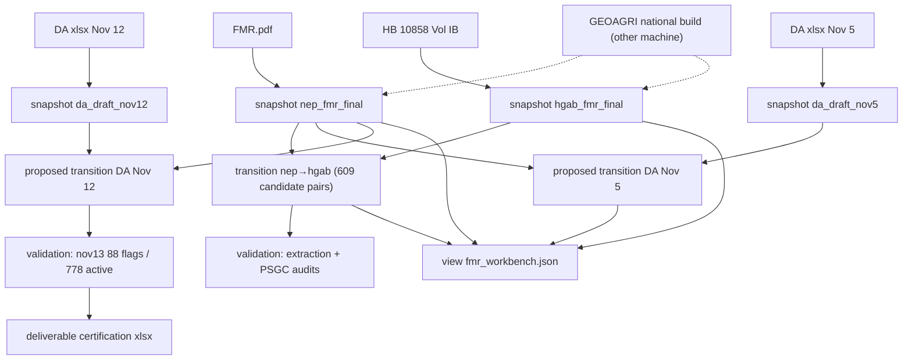
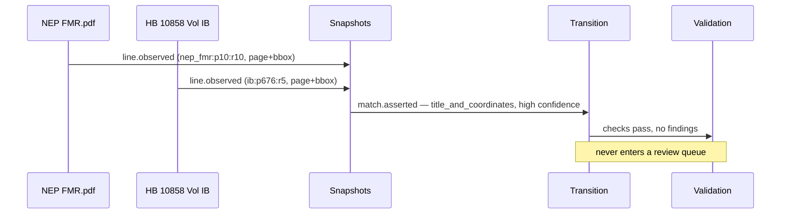
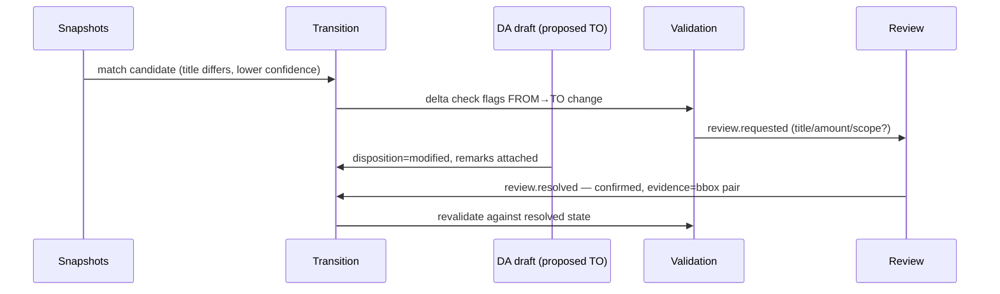
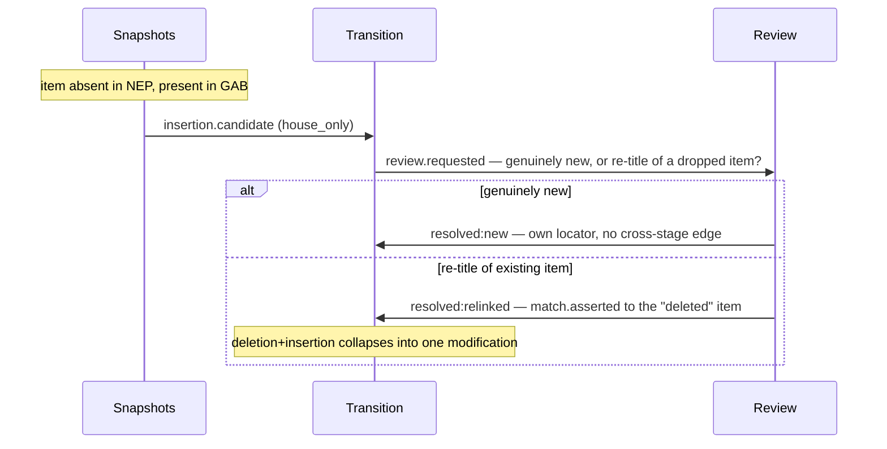
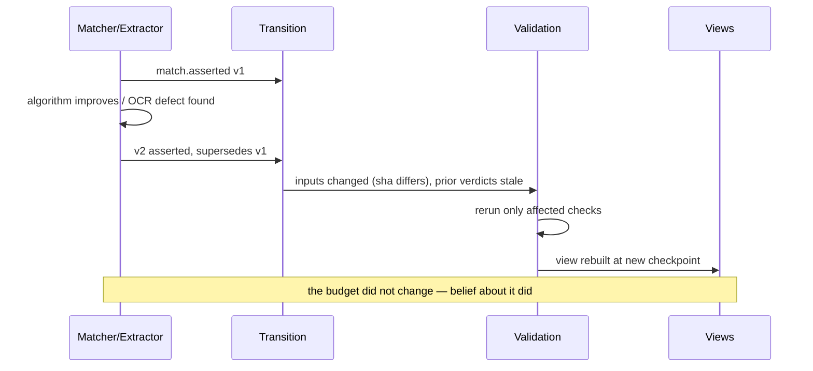
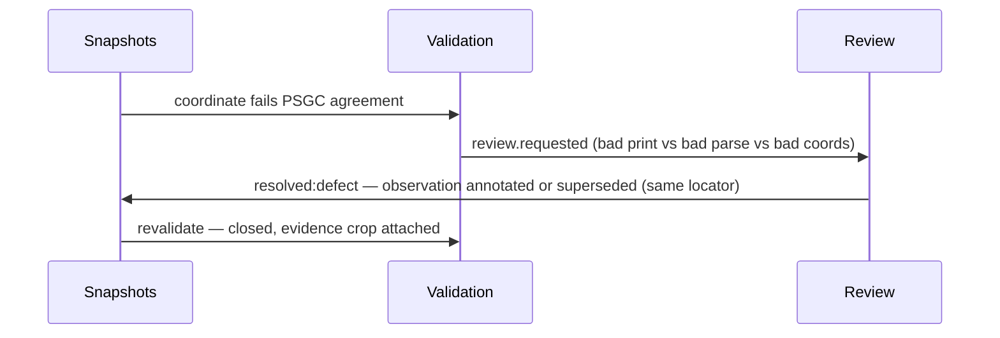
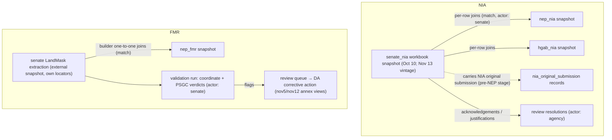
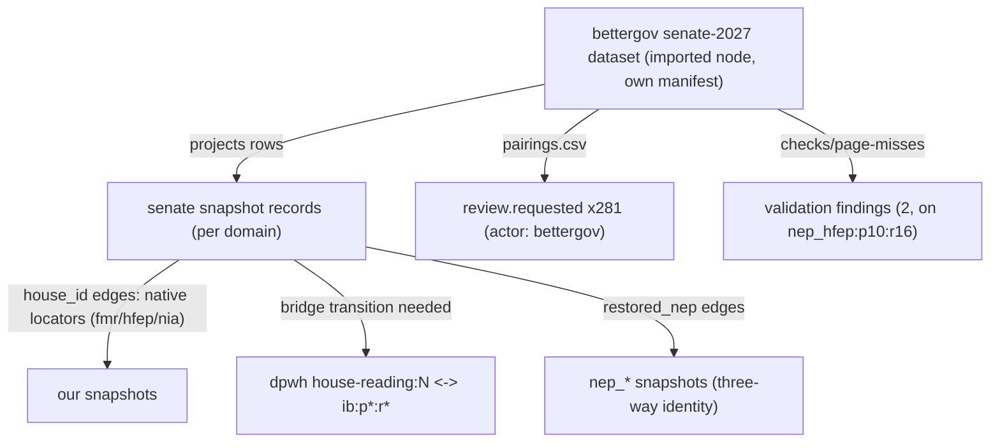

# FY2027 Budget Workbench — Data Formalization Design

Status: draft (design converged 2026-11-22; implementation not started)
Scope: repo-wide model, piloted on the DA FMR domain
Companions: `data_formalization/data/` (future manifests, registry, lineage index)

---

## 1. Problem

The workbench tracks FY2027 Philippine budget line items across document stages
(DBM NEP → House GAB readings → DA working drafts → future Senate/BIC/GAA), but
the current data layout has four structural problems:

1. **Monolithic payloads.** Workbench JSONs (e.g. `fmr_workbench.json`, 7.7 MB)
   fuse stage data, matching results, and audits into one file. Any input
   change forces a full rebuild; the React app couples to that shape.
2. **Deliverable churn.** Real artifacts arrive wearing date-suffixed
   deliverable names (`*_nov5`, `*_nov12`, `*_nov13`). A new document edition
   means hand-copied bespoke exports instead of a pipeline step.
3. **Scattered validation.** Audits live per domain in ad-hoc shapes
   (`*_audit.json`, `input_sha256` pins, CI `--check` gates, review CSVs).
   "Is anything stale?" has no single answer.
4. **No first-class change tracking.** "What happened to this line item across
   stages?" requires knowing which monolith to open and which fields to diff.

The rework makes **snapshots, transitions, and validation runs** first-class,
connected by an artifact-level **DAG** with per-line-item traceability.

## 2. What we already have (and keep)

The repo is closer to the target model than the problems suggest:

- Cell-level provenance already exists on every project record:
  `source_pdf`, `pdf_page`, `printed_page`, `table_row`, `bbox`,
  `amount_cell_bbox`; per-snapshot locator IDs (`nep_fmr:p10:r10`,
  `ib:p676:r5`, `da_fmr:r222`); source sha pinning on extracted files
  (`source_xlsx_sha256`).
- `{stage}_{domain}_{artifact}` naming (FMR/HFEP/NIA) already separates
  snapshots in all but name.
- `input_sha256` pinning on comparison payloads and `comparison_manifest.json`
  are embryonic lineage manifests.
- `master_list/data/applied_suggestions.jsonl.gz` + audit proves the
  append-style review pattern already works in production here.

**The rework is repackaging, not extraction rework.**

## 3. Dataset category map

Nine categories, mapped from the full repo inventory:

| # | Category | Members (representative) | Role in new model |
|---|----------|--------------------------|-------------------|
| 1 | Primary source documents | NEP OCR PDFs, HB 10858 2nd/3rd reading PDFs, annex PDFs, NIA/DA xlsx workbooks, Transparency combined snapshot, GEOAGRI shapefile export (external drive) | DAG leaves; immutable |
| 2 | Stage extractions | `{stage}_{domain}_*`: tree, source_rows, projects, coordinates_normalized, final_dataset | **Snapshot nodes** |
| 3 | Comparisons | stage_trace (54 MB), house_reading_changes (37 MB), source_comparison (43 MB), comparison_projects (50 MB), workbench comparison lists, road_group_candidates + group_relations_*, GEOAGRI matches | **Transition nodes** |
| 4 | Validation runs | extraction audits, tree validations, amount audits, PSGC/coordinate validations, NIA nov13 ledger set, master_list audits | **Validation nodes** |
| 5 | Derived app payloads | main_overview, highlights_details, workbench JSONs, legislative/location indexes, master_list releases | **View nodes** (rebuilt from core) |
| 6 | Reference & crosswalks | PSGC2LEG, DEO2LEG, bridge_inventory, submodules | Reference nodes; identity spine |
| 7 | External enrichment | GEOAGRI enrichment/matches/geometry, gps_inventory | Transition/enrichment nodes; may be built on another machine |
| 8 | Evidence artifacts | evidence_crops, printed-control images, page-referenced listings, source-review manifests | Attachments referenced by validation/review edges |
| 9 | One-off deliverables | nov5/nov12 flags annexes, REVISED NEP exports, NIA message trio + 12 CSVs | Re-typed: snapshots (Nov 12 workbook), validation runs (flags), views (exports) |

Key re-typings: `fmr_revised_nep_nov12_*` is really a **new stage snapshot**;
`nia_flags_ledger_nov13` is really a **validation run**; the 2nd/3rd reading
33 MB file twins are one snapshot plus a **verified-identical transition**.

## 4. Stage model

Two kinds of "stage" were conflated in the current `fmr_workbench.stages`:

- **Official legislative documents** — immutable snapshots:
  NEP (DBM submission), House GAB 2nd reading, House GAB 3rd printing
  (verified identical to 2nd across 123 annex pages by `reading_comparison()`),
  and future Senate / BIC / enrolled / GAA printings.
- **Agency working drafts** — DA FMR Nov 5 and REVISED NEP Nov 12 are not
  stages. They are FROM→TO **proposed transitions** whose FROM side references
  the NEP snapshot (dispositions: retain / new / modified / list_revision).
  GEOAGRI proposals are pre-budget **enrichment**, not a stage at all.

A declarative **stage registry** (one JSON per domain) replaces hardcoded
stage lists: `stage_id`, `kind` (official | agency_draft | enrichment),
source document + sha256, extractor + version, row/total counts.
Adding the Senate printing becomes a registry entry, not a refactor.



## 5. Lineage model: a two-layer DAG

Rejected alternatives, for the record:

- **Append-only event ledger.** Good for facts, but matches/validations are
  *assertions* that get superseded; a global sequence also wants a single
  writer, which conflicts with the two-machine build reality (GEOAGRI national
  build runs on another box). Supersession semantics survive as typed edges.
- **Plain per-item change log.** Cannot express type-changing resolutions
  (deletion+insertion collapsing into a retitling) or belief updates with no
  document event.

A DAG subsumes both: nodes are immutable and content-addressed; "changing" a
derived artifact means adding a node whose inputs point at the old one.

### Layer 1 — Derivation DAG (artifact lineage)

Every artifact is a node with a manifest:

```json
{
  "node": "transition/nep-hgab@9f3c2e",
  "type": "transition",
  "content_sha256": "…",
  "built_by": {"builder": "other-analysis/build_fmr_workbench.py", "version": "git:e29cd43"},
  "inputs": ["snapshot/nep_fmr_final@a71b…", "snapshot/hgab_fmr_final@c02d…"],
  "ts": "2026-11-22T09:14:00+08:00"
}
```

Node types: `source_doc`, `snapshot`, `transition`, `validation`, `view`,
`reference`, `deliverable`. A registry (one JSON index per domain) maps
node IDs → manifest paths. Git stays the macro-DAG (commits); this is the
artifact-level DAG inside it.



### Layer 2 — Identity graph (inside transitions)

Line items keep **per-snapshot locator IDs** as canonical subjects. No global
project ID is ever minted — cross-stage identity *is* the match-edge graph,
which keeps the "pairings are candidates, not authenticated" disclaimer
structurally true. Match edges carry method, confidence, and a `supersedes`
pointer for rematch versioning. The storage mechanism for identity edges and
all other per-line-item records is the ledger (§6).

**Durable-id exception (validated 2026-11-22):** when the *source itself*
assigns a stable identifier, the locator-per-snapshot rule bends — the
durable id becomes the subject and per-snapshot locators become provenance.
Case: DA FMR working drafts. Excel row locators (`da_fmr:r###`) shift
wholesale between the Nov 5 and Nov 12 drafts (1,021/1,021 common controls
changed rows; 888/991 same-id rows are different projects), while DA's own
`control_no` has zero drift (0/1,021 common controls differ in title or
amount). Subjects are therefore `da_fmr:ctrl:<control_no>`; row locators
ride along in `provenance.row_locator`. Same expected to apply to NIA and
HFEP if agency-assigned control numbers exist there.

## 6. The line-item ledger (append streams)

Document-scoped artifacts (snapshots, match runs) are rebuilt wholesale and
stay DAG nodes. But findings, verdicts, corrections, and reviews arrive
**one line item at a time, from different actors** — and the proven pattern
for those is append-only per-subject records, not bulk files. Three working
precedents in this repo: `master_list`'s `applied_suggestions.jsonl`
(production), the bettergov dataset's `checks.csv`/`page-misses.csv`/
`pairings.csv`, and the Romualdez defect resolution (below).

### Record types (= the §7 path-grammar edge set)

`line.observed` · `match.asserted` / `match.retracted` · `validation.finding`
· `validation.run` (supersedes prior runs of the same check+subject) ·
`review.requested` / `review.resolved` · `defect.repair` ·
`deliverable.published`

### Envelope

```json
{"seq": 4, "ts": "2026-11-22T16:50:00+08:00",
 "subject": "nep_hfep:p10:r16",          // per-snapshot locator — never a global id
 "type": "review.resolved",
 "payload": {…},                          // type-specific
 "actor": "reviewer:user|pipeline|agency|senate|bettergov",
 "provenance": {"snapshot": "nep_hfep@a71b…", "page": 10, "printed_page": 728, "row": 16},
 "supersedes": null}                      // seq of the record this replaces
```

### Semantics and guards

- **Fold**: current truth for a subject = fold its records in seq order.
  Per-subject ordering only — no global sequence, so multi-actor appends
  need no coordination (the property the rejected global event log lacked).
- **Supersession, never edits**: re-validations and rematches append records
  that supersede prior ones. The ledger file is append-only.
- **No re-extracted content**: the ledger references snapshots by locator;
  it never copies titles/amounts wholesale. Full row content lives in the
  snapshot; the ledger holds interpretation (defects, verdicts, resolutions).
- **Storage**: JSONL per domain under `data_formalization/data/ledger/`;
  a small `append.py` assigns seq per subject and refuses rewrites. Scale:
  ~45k line items ≈ hundreds of KB–tens of MB — trivially file-scale.

### Worked example (the Romualdez case, closed 2026-11-22)

The first complete ledger sequence, from real work:

```jsonl
{"seq":1,"subject":"nep_hfep:p10:r16","type":"line.observed",
 "payload":{"label_raw":"cYanmGtalo  Tab]","amounts":{"infra":10000000,"med":30000000,"total":40000000}},
 "actor":"pipeline","provenance":{"snapshot":"nep_hfep","page":10,"printed_page":728,"row":16}}
{"seq":2,"subject":"nep_hfep:p10:r16","type":"validation.finding",
 "payload":{"check":"page-link-title","result":"miss","note":"garbled title"},
 "actor":"bettergov","provenance":{"source":"senate-2027-page-misses.csv"}}
{"seq":3,"subject":"nep_hfep:p10:r16","type":"validation.finding",
 "payload":{"check":"ocr-garble","result":"confirmed","independent_extraction":"nep_hfep_source_rows.json"},
 "actor":"verify_senate_dataset.py","provenance":{"source":"Senate_report_data/docs/verification_report.json"}}
{"seq":4,"subject":"nep_hfep:p10:r16","type":"defect.repair",
 "payload":{"true_label":"Governor Benjamin T. Romualdez General Hospital and Schistosomiasis Center",
            "evidence":["manual page read","dbm-other-nep-line-data/HFEP_2.pdf"]},
 "actor":"reviewer:user","supersedes":null}
```

### Three-tier summary

**snapshots/transitions** (document-scoped, content-addressed, rebuilt
wholesale) → **ledger** (per-line-item appends: the interpretation layer)
→ **views** (workbench JSONs, folded from both).

## 7. Revision path grammar (sequence types)

Five distinct revision/update path types, verified against real records.
Each sequence is one protocol; every line item's history must parse as one of
these. A history that doesn't parse is itself a bug signal.

**Edge types** (the complete set): `line.observed`, `match.asserted`,
`match.retracted` (supersession), `validation.run`, `review.requested`,
`review.resolved`, `deliverable.published`.

### Path A — Quiet survivor (majority; 289 retain)



### Path B — Modified item (168 modified; e.g. da_fmr:r222 title correction)



The nov13 "88 red flags addressed" set is 88 instances of this path.

### Path C — Insertion / Deletion (355 house-only, 95 nep-only; 236 new)



This is the path where review **changes the type of the change** — why a
naive change-log is insufficient.

### Path D — Knowledge update, no new document (rematch v2, defect repair)



### Path E — Printed/data defect (HFEP defect ledger; FMR coordinate issues)



## 8. External review: Senate materials

"Senate review data" is not a stage — it is an *actor*. Two materially different
artifact families arrived under that name, and both fit the existing node types
once edges carry an `actor` field.

### A. Reconciliation exhibit as snapshot (NIA)

`NIA_DATA/NIA FY 2027 NEP OCTOBER 10 1043PM.xlsx` (committed, sha-pinned in
the workbench; `NIA_NEP_2026-11-13.xlsx` is a second vintage) is a Senate
hearing exhibit carrying, per row: published NEP detail, House GAB amounts,
the **NIA original submission**, edit acknowledgements, and justifications
(937 rows; 791 NEP-funded, 828 House-funded, 145 House insertions, 108
House-zeroed, 782 submission-edited, 94 justified, controls reconciled).

In the model:

- The workbook is a **snapshot** (own locators `senate_nia:*`). Its per-row
  NEP/House columns are **match assertions** into the `nep_nia` and `hgab_nia`
  snapshots, made by the exhibit's authors.
- It extends the stage chain *backward*: `nia_original_submission → NEP →
  GAB`. The workbook is the only surviving record of the pre-NEP agency
  stage; register that stage with the workbook as its carrier document
  (`origin: senate_hearing`).
- Edit acknowledgements / justifications are **review resolution records**
  (actor: agency, context: senate hearing) — Path B resolutions with a
  legislative trigger.

### B. Third-party checks as validation runs (FMR)

`external_work/senate_data/FMR_2027_NEP_vs_GAB_PY LandMask.xlsx` (not
committed; lives on the other machine) holds sheets 'NEP extracted' /
'GAB extracted' — the Senate's independent extraction of the same annex
PDFs, annotated with per-row coordinate-validity and PSGC location-check
verdicts, produced for the Senate statement.

In the model:

- Their extraction is a **snapshot** with own locators
  (`senate_fmr_nep:*`, `senate_fmr_gab:*`) — an independent read of the same
  source documents, kept distinct from ours.
- `build_fmr_flags_annex.py`'s one-to-one joins (canonical title+amount, then
  title, then difflib similarity ≥ 0.75 with ≥ 0.05 margin within
  region/amount buckets) are **match assertions** (actor: senate/builder)
  linking their rows to our locators.
- Their coordinate/PSGC verdicts (Invalid / Check / Valid-reversed /
  Valid-typo-corrected; PSGC Check / Mismatch / Not found) are **validation
  runs** with `actor: senate` over the joined lines — structurally identical
  to our own coordinate validations, so cross-actor agreement/disagreement
  becomes a query.
- DA corrective-action classification (nov5/nov12 flags annexes) is a
  **review resolution** layer responding to those external verdicts; the
  annex CSV/XLSX files are views over it.

### Schema addition

Match, validation, and review edges gain `actor`
(`pipeline` | `agency` | `senate` | `reviewer:<id>`) and, where relevant,
`origin` (document context). No new node type is introduced. The stage
registry marks Senate exhibits `kind: official, origin: senate_hearing` and
third-party extractions `kind: external_extraction`.



Open item: copy the FMR LandMask workbook from the other machine and register
it as a source-doc node with a sha pin — it is the only FMR Senate artifact
not yet under lineage.

## 9. Traceability chain

Any enacted-amount question resolves through named, checksummable hops:

```
UI row → view → transition edge (method, confidence)
  → {nep_id, house_id} → snapshot records
    → source locator {pdf, page, bbox} + source sha256 → the PDF cell itself
```

Per-line-item timeline = replay of one item's edges sorted by time
(renderable as its sequence diagram on demand). Review queue = "nodes/edges
with an open review attached."

## 10. Mechanics — deliberately boring

- **No database, no service.** Nodes are committed files + a small manifest
  registry. One `lineage.py` tool: `verify` (recompute node from inputs,
  byte-compare — CI), `diff` (staleness/changes between checkpoints),
  `query` (per-item timeline, review queues).
- **Builders emit manifests automatically** via a thin wrapper — discipline
  enforced by tooling, not memory.
- **SQLite optional**, as a rebuildable query index over manifests, never
  source of truth.
- **CI** = `verify` all nodes + rebuild views + byte-compare + re-run only
  validations whose input shas changed (generalizes today's
  `input_sha256`/`--check` gates).
- **Scale**: all domains ≈ 60–80k line items, hundreds of nodes — trivially
  file-scale.

## 11. Trusted inputs and rebuild cost (settled 2026-11-22)

Two decisions that fell out of verification work:

### Trusted-import posture

All existing extractions are **trusted inputs** — registered as imported
snapshot nodes (like the bettergov Senate dataset), never rebuilt:

| Domain | House GAB | NEP | Senate | Provenance quality |
|---|---|---|---|---|
| FMR | `hgab_fmr_*` family | `nep_fmr_*` family | bettergov import | full bboxes |
| HFEP | `hgab_hfep_*` | `nep_hfep_*` + defect ledger | bettergov import | full bboxes |
| NIA | `hgab_nia_*` | `nep_nia_*` + senate workbook | bettergov import | full row refs |
| DPWH | `hb_dpwh_native_*` | `nep_2027_*` + transparency tree | bettergov import | `source.pdf_page` per leaf + payload sha |

Basis: sha-pinned sources, committed audits, 123-page reading verification,
and the 2026-11-22 cross-verification of the Senate import
(`Senate_report_data/docs/VERIFICATION.md`, `CROSS_COMPARISON.md`,
`EDGE_CASES.md` — 74 checks across both suites, 0 blocking failures).

**PDFs re-enter only for genuinely new documents** (BIC, enrolled bill, GAA)
or proven extraction defects — the Romualdez pattern: defect →
`defect.repair` ledger record superseding the observation at the same
locator, never a wholesale re-extract.

### Measured rebuild costs (this machine, 2026-11-22)

| Layer | Rate / time | Note |
|---|---|---|
| pymupdf word extraction (coords) | 192 pages/sec | measured on all 768 Senate pages |
| pdfplumber word extraction | 2.6 pages/sec | reserve for tricky annexes (A-1, A-2, GS) |
| Cold rebuild incl. PDFs | ≈ 30–60 min | matching dominates; OCR re-runs and GEOAGRI excluded (imports) |
| **Ledger backfill from trusted snapshots** | **≈ 5–10 min, PDF-free** | the actual remaining work |
| Per-line-item provenance overhead | ≈ 0 | coords captured during extraction anyway; ledger ≈ 15 MB |

## 12. FMR migration plan (pilot)

0. Register existing extractions as trusted snapshot nodes (no rebuild);
   backfill the per-line-item ledger from them (§11).
   **Status: DONE 2026-11-22.** 9 lineage nodes registered (4 source docs, 4
   snapshots, 1 import); ledger backfilled with 6,230 records over 3,901
   subjects in 1.5 s (`scripts/backfill_fmr.py`). Tools: `scripts/ledger.py`
   (append/fold/timeline/verify), `scripts/lineage.py` (register/list/verify/
   stale/graph). Tamper detection verified: modifying a snapshot on disk is
   flagged by `lineage.py verify` (content sha mismatch), restoring clears it.
   **Identity discovery:** across DA drafts Nov 5 → Nov 12, `da_fmr:r###`
   row-locators are *unstable* (1,021/1,021 shared ids moved rows; 888/991
   same-id rows carry different projects) while `control_no` is stable (0
   drift in title/amount across 1,021 common controls). DA ledger subjects
   are therefore `da_fmr:ctrl:<control_no>`; row locators are demoted to
   provenance. This is the model's claim — locator per snapshot, durable id
   only where the source assigns one — validated on real data.
1. Node schema + manifest registry for the four snapshots and the
   `nep→hgab` transition — backfilled from existing files, no data movement.
   **Status: DONE 2026-11-22.** `scripts/transitions_fmr.py` replays the
   609 nep→house edges and 699 DA linkage edges *from the ledger* into
   `data/transitions/fmr/*.json` and registers them as nodes
   (`transition/fmr/nep_to_hgab`, `transition/fmr/da_nov5_linkage`) —
   first half of the step-3 replay proof (ledger ⊇ transitions).
   Edge targets follow `match_side`: 696 DA controls matched the NEP
   formulation, 3 the House formulation (was a backfill bug, fixed).
2. `lineage.py` with `verify` + a lineage-diff demo: nov5 → nov12 DA draft
   as a graph diff (rows added, FROM amounts moved, match edges broken).
   **Status: DONE 2026-11-22.** `view/fmr/da_nov5_to_nov12_diff`
   (`data/transitions/fmr/da_nov5_to_nov12_diff.json`), keyed by
   control_no: +11 / −1 controls, 8 disposition changes (7 drops, CAR-0013
   revived dropped→retain with ₱11M restored), 0 FROM-amount/title moves,
   0 match-basis breaks. **The diff immediately caught a real defect:**
   nov12 excel row 34 is a mid-sheet repeated header that leaked into the
   trusted extraction as control `Control No.` — recorded as the ledger's
   first live `validation.finding` (subject `da_fmr:ctrl:Control No.`,
   check `spurious-header-row`, upstream `extract_da_fmr.py` header
   filter). Repair pending upstream extractor fix + re-extract.
3. Equivalence check: replay the DAG to rebuild `fmr_workbench.json`;
   assert byte-equality with today's file. React app untouched.
4. Re-type the deliverables: Nov 12 workbook → snapshot; nov13 flags →
   validation runs over the Nov 12 proposed transition.
5. Replicate to HFEP, NIA, then DPWH core (the big monolith payloads:
   stage_trace, comparison_projects, source_comparison).
   **Status: DONE 2026-11-22** for ledger coverage — HFEP (977 observed +
   341 pairs), NIA (791+828 observed, agency recon wired with 631 match
   edges), DPWH (17,633 stage_trace observations; review-set import +
   bridges A/B: 31,701 edges). Remaining depth work: DPWH monolith
   decomposition into per-snapshot layers, and cross-checking NIA senate
   pairs against agency-recon deltas.

## 13. Stress test: the Senate committee report dataset (2026-11-22)

`Senate_report_data/` delivered the real Senate stage — the budget.bettergov.ph
dataset built 2026-11-21 from the Senate Finance committee report on HB 10858
(8 born-digital PDFs, sha-pinned in its manifest). It stress-tests the model
four ways at once: it is the "future Senate stage" arriving, it is a
**third-party actor** dataset, it spans **all four domains**, and it ships its
own validation checks.

### What arrived

| File | Rows | Model mapping |
|---|---|---|
| projects | 20,835 (dpwh 17,613 · fmr 1,200 · nia 1,117 · hfep 905) | snapshot records + match edges (fused) |
| annex-a | 2,719 line-by-line amendments | snapshot (amendment observations) |
| general-summary | 450 | snapshot (control totals) |
| provisions | 186 | snapshot (provision amendments — **new record grain**) |
| pairings | 281 | **review queue** (their own open questions) |
| checks / page-misses | 38 checks (37 pass) / 2 misses | **validation run** with findings |
| manifest.json + SHA256SUMS | — | lineage manifest (inputs, built_by commit, file shas) |

### Findings

1. **Foreign DAG nodes import whole.** The dataset arrives manifest-complete
   (source PDF shas, builder commit, per-file sha256, validation checks).
   Re-decomposing a working foreign pipeline would be busywork: register the
   dataset as one imported node whose manifest points at its own manifest.
   Rule: *decompose our pipelines; import theirs.*
2. **Locator compatibility is 3/4 native.** Their `house_id`s for FMR/HFEP/NIA
   literally reuse our locator vocabulary — `pair:nep_fmr:p20:r10:ib:p685:r16`,
   `house_only:ib:p897:r9`, `ib:p…` — including in `page-misses.csv`
   (`nep_hfep:p10:r16|infrastructure`). DPWH alone uses a foreign numbering
   (`house-reading:29`), so a **bridge transition** (their DPWH ids ↔ our
   `ib:` locators, page-cited) is the only join we must build.
3. **Their status taxonomy maps onto the path grammar.** `unchanged`→A,
   `reduced`/`raised`→B, `cut`→C-deletion, `renamed` (via `rename_pair`)→
   C-relink, `added`→C-insertion, `restored`→**C-insertion resolving to a
   pre-House NEP item** (three-way identity; `restored_nep` edges),
   `nep_only`→baseline-only observation. Their `status` values stay *their*
   assertions (`actor: bettergov`); our classifications are computed over
   imported edges, never overwritten.
4. **Their open questions are review records.** `pairings.csv`
   (`possible_duplicate`, `same_facility`, 281 rows) imports as
   `review.requested` edges with `actor: bettergov`; `page-misses.csv` (2
   HFEP NEP rows with garbled OCR titles) imports as validation findings on
   our `nep_hfep:p10:r16` locator. `under_citizen_review: true` in the
   manifest → one review.open on the imported node.
5. **Fused ids confirm the decomposition rule.** Their paired rows use
   `id = pair:nep_fmr:p20:r10:ib:p685:r16` — the pairing is fused into the
   identifier itself. Our model keeps the Senate observation locator
   (`senate-fmr-*` / page+row) separate from the match edge; their pair-id
   becomes an edge attribute, not an id.

### New vocabulary required (minimal)

- `origin: external_actor` on imported nodes; `actor: bettergov` on imported
  edges.
- `restored_nep` match edges (three-way: senate insertion ↔ NEP item absent
  from House).
- Bridge transitions for foreign locator spaces (DPWH only, currently).
- Provision amendments (Annex B, 186 rows) extend the record grain beyond
  line items — handled as a snapshot of a different record type, no schema
  change.



Verdict: the model holds under the full event — no new node types, minimal
vocabulary additions, and the Senate stage lands as an import + one bridge
build rather than a refactor.

## 14. Connection inventory (what joins what, via which file)

Measured 2026-11-22 by probing the files themselves; recompute with
`scripts/coverage.py` when sources change. Connection strength per domain:

| Domain | Chain | Connector file(s) | Key / evidence |
|---|---|---|---|
| FMR | NEP→HGAB→DA(2 drafts)→Senate, **complete** | `other-analysis/data/fmr_workbench.json` | 609 nep↔house pairs; 699 DA links keyed `control_no`; senate `house_id` embeds our `pair:`/`ib:` locators |
| HFEP | NEP→HGAB→Senate | `other-analysis/data/hfep_workbench.json` `comparison.pairs` | 341 pairs with similarity; senate refs `ib:`/`pair:` |
| NIA | NEP→HGAB **via agency recon** + Senate | `NIA_DATA/NIA_NEP_2026-11-13.xlsx` (and Oct 10 vintage) | agency-side NEP (col H) vs HGAB (col I) per leaf, formulas resolved: 803 numeric leaves — 679 identical / 16 changed / **108 cut-to-zero**; title overlap with our `nep_nia_dataset.json` 628/797 (79%) |
| DPWH | fused traces + 3rd-reading import + bridge needed | `analysis/data/stage_trace_2027.json`; `dpwh_HGAB_REVIEW_SET/` (bettergov, Vol I-C) | stage_trace fuses api/nep/house ids internally; review set uses `hgab_id=HB10858-3-<page>-<row>`; senate `house-reading:N` is a sequential index — 99% title-match to review set (2,966/3,000 probe) |

Foreign locator vocabularies and their bridges:

- `house-reading:N` (senate dpwh) ↔ `HB10858-3-*` (review set): **title-match
  bridge, computable** (99% probe hit rate).
- `HB10858-3-*` (Vol I-C, 3rd reading) ↔ our `ib:*` (Vol I-B, 2nd reading):
  same bill, different printings — needs its own build (title+amount,
  page-cited); this is the DPWH analogue of NIA's agency reconciliation.
- NIA senate `pair:` refs (606) become **corroborated** once matched against
  the agency recon leaves (previously uncorroborated external assertions).

Registration posture: NIA agency xlsx pair →
`snapshot/nia/agency_recon_{oct10,nov13}` (same-role rule as DA drafts);
review set → `import/dpwh_hgab_review_set` (foreign DAG node, own manifest —
"decompose ours, import theirs").

**Wired 2026-11-22** (`scripts/wire_new_sources.py`, idempotent):

- NIA: both recon vintages extracted (`extract_nia_recon.py`, sha-pinned,
  formulas resolved via cached values — plain parses undercount: 2 vs 108
  cuts) → 797 leaves observed each; 631 `match.asserted` edges
  nep_nia ↔ agency leaves (title-key exact). Cross-vintage diff
  (`view/nia/agency_recon_oct10_to_nov13_diff`): 1 added / 1 removed /
  0 amount changes — the pair is actually one province correction
  (`Santa Maria PIP, Cagayan→Isabela`). Earlier "274 leaves differ"
  was a positional-zip artifact (same row-shift lesson as DA: key by
  content, never by row).
- DPWH: review set imported — 15,979 `line.observed` (subjects
  `hgab3:HB10858-3-*`), 90,285 red flags as `validation.finding` (actor
  bettergov). Bridge A (stage_trace `hb:ic:*` ↔ review set, same Vol I-C
  dialect): 15,849 edges, 124 ambiguous-title holds, 297 misses. Bridge B
  (senate `house-reading:N` ↔ review set): two-pass title match — senate
  title first, then their `house_title` column, which rescues renamed rows
  (renames were 86% of the misses) — 15,852 edges (98.2%), 420 unresolved
  as `review.requested`.
- NIA senate `pair:` refs (606) now corroboratable: senate pair edges can
  be checked against agency-recon deltas (108 cut-to-zero leaves) — a
  validation script for this is the natural next step.

**Senate A-4 re-derivation 2026-11-22** (`scripts/wire_senate_a4.py`,
idempotent; phases R1–R4): the DPWH Senate slice is now **own extraction,
not import**. Chain: `source/senate/annex_a4_pdf` →
`snapshot/senate/annex_a4_dpwh` (`Senate_report_data/scripts/extract_annex_a4.py`,
adapted from `bettergovph/ai-budget` `parse_annex_a4.py` MIT — same column
geometry REV_X=326/AMT_X=545/PROJECT_X=104, plus per-row provenance) →
`view/senate/annex_a4_dpwh_mapped` (page-citation-anchored join: A-4's
printed HB page + 8 = Vol I-C PDF page — offset verified **uniform** across
all 210 pages by 4,530 exact-name+amount anchors; then title/amount
tie-breaks within page). Ledger: 8,713 `line.observed` (subjects
`senate_a4:p<page>:r<top>`), 8,705 `match.asserted` →
`house:hb:ic:<tree node>` (99.91%; match stats: 6,432 page_exact /
1,075 page±1_exact / 77 page_amount_office / 1,115 global_exact / 2
amount_unique / 4 fuzzy90; 8 unmatched — all cuts resolvable by title
prefix), 505 previously-unobserved house tree nodes (495 project + 10
fap_project, house insertions outside the stage trace) backfilled from
`snapshot/dpwh/hb_ic_3rd_reading_tree`, and one `validation.run`
corroboration: vs bettergov's published dpwh rows, **8,591/8,591 status
agreement, 0 contradictions**; residual 53-ours/15-theirs rows fully
explained (13 FAP list-marker prefixes, 2 title-wrap artifacts). DPWH A-4
renames are document-native (House and Revised titles printed side by
side) — no inference needed, unlike A-1/A-3 (FMR/NIA) where corrections
print as separate removal+insertion rows and pairing must be inferred
(bettergov's `pairs.py` approach: annex's own link or ≥85 similarity).

**Senate A-1/A-2/A-3 re-derivation 2026-11-22**
(`data_formalization/scripts/wire_senate_annexes.py`, idempotent): the
FMR/HFEP/NIA Senate slices are now also own extraction. Extractors
`extract_annex_projects.py` (A-1/A-3 two-column layout) and
`extract_annex_a2.py` (A-2 facility tree), both adapted from
bettergovph/ai-budget MIT parsers with our envelope; reconciliation to
printed totals: FMR ₱19,628,100,000 → ₱16,000,000,000 exactly, HFEP
component sums equal the grand total to the peso (₱5,491.4M), NIA 148
cuts. Mappers `map_annex_projects.py` / `map_annex_a2.py` join against
OUR snapshots (FMR workbench house projects, NIA hgab CSV, HFEP workbench
facilities): FMR **964/964** house rows matched (938 exact / 24 prefix /
2 fuzzy), NIA **828/828**, HFEP 44 facility edges (41 same_name + 3
similar, 145 new components); cross-check vs bettergov house locators:
**0 disagreements** on all three. Replacement linking (the delete+insert
pattern): FMR **153** `replaces` edges via full within-region scored
greedy match (same municipality; sim ≥85 with same amount, ≥93 title-
only; prefer cut-before-insert; 1–1) — catches cross-page pairs like San
Lorenzo Bangui cut p1 / insert p6. House-hub view: **153 realigned** /
**424 true cuts** (annex cut+insert is a correction, not a net removal).
NIA **0** replaces (its insertions are other systems). Ledger wired;
integrity ALL CLEAN.

## 15. Non-goals

- No event-store service, message bus, or daemon.
- No event-sourcing of derived analytics (rollups, alluvials stay computed).
- No global project identity (subjects stay per-snapshot locators).
- No global ordering across ledger subjects (per-subject seq only).
- No re-extraction of trusted snapshots; PDFs only for new documents or
  proven defects.
- No hash-chaining of nodes (git history suffices; revisit only if
  tamper-evidence beyond git is ever required).
