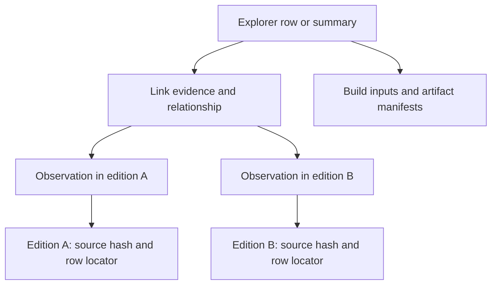

# Chaining budget records for traceability

Use the [web app build guide](provenance_explorer_build_guide.md) when
wiring a program export into the shared explorer.

## 1. General ideas

**Scope.** This guide covers the FY2027 DPWH, NIA, and FMR annexes. Use
the same traceability model across all three and select the linking
rules for each source pair. A printed page reference, an agency workbook
control, and a road’s endpoints answer different identity questions.

A trace starts with a question about a line item. Where did it appear?
What changed between documents? What evidence connects those records?
A reader should be able to follow any displayed title, amount, or action
back to the exact source row and understand how the chain was assembled.

The chain is a view of the available evidence. It can span official
printings, agency proposals, and review artifacts. Each source supports
a different claim. A printed Senate insertion establishes what appears
in the annex. Agreement with an agency draft establishes a correspondence
between the two records. The Senate’s decision process requires its own
evidence.

Define the unit being traced before linking. An irrigation system can
contain multiple workbook leaves. A facility can have separate funding
components. A road can have multiple ordered segments. Preserve those
relationships and compare records at comparable levels. A chain can
branch at a split or merge and can skip stages where no row is available.

This guide describes how to construct and review a trace. The repository’s
[data model](../data_formalization/docs/DATA_MODEL.md) defines storage,
artifact lineage, and ledger events. The
[FMR edge-case reference](fmr_budget_chain_edge_cases.md) and
[NIA Explorer notes](nia_provenance_explorer.md) and
[DPWH Explorer notes](dpwh_provenance_explorer.md) document program rules.

## 2. Main concepts

| Concept | What to record |
| --- | --- |
| **Source artifact and edition** | Document role, edition or draft date, baseline, coverage, and content hash. Record whether it is a complete printing, a change-only annex, an agency proposal, a review artifact, or reference data. |
| **Observation and locator** | The value as printed or recorded, its unit, and a locator scoped to the source edition. For PDFs use the page and row or bounding box where available. For workbooks use the sheet and row or cell range, plus the source-assigned control if present. |
| **Normalized fields** | Comparable values used for matching, such as an agreed region key, title tokens, integer pesos, and ordered endpoints. Retain the original text and any extraction repair with its evidence. |
| **Link assertion** | Both source locators, the relationship being asserted, the matching rule or review decision, supporting fields, discrepancies, and evidence status. The stability of the underlying identifiers is part of the evidence. |
| **Chain view** | A rebuildable summary of observations and links. Record the anchor, which values and actions it displays, and how it counts grouped rows. A view can show a tentative grouping with a warning while retaining separate source records. |
| **Finding, fix, or review decision** | The source or check that raised the finding, the affected observation or link, the proposed or verified fix, and supporting evidence. Use the ledger’s review and supersession mechanisms where the decision is persisted. |

The repository tracks two kinds of provenance. **Artifact lineage** shows
which versioned inputs produced an extract or view. **Line-item links**
explain why two observations appear in the same chain. The UI should let
a reader follow both paths.

### Identity and source actions

Use an edition-scoped locator as the default observation identity.
A stable source-assigned control can identify a subject across editions
when its continuity is verified. Retain each edition’s locator even
when the control is unchanged. Keep the chain’s display anchor separate
from the identifiers used to retrieve source rows.

Record the printed action and the relationship as separate facts. A
Senate row may be printed as an insertion while the chain classifies
the project as reinstated from NEP. A cut and insertion may have a
proposed replacement link, with both original actions still available.
For agency drafts, keep **FROM**, proposed **TO**, and effective amounts
distinct. Parallel drafts can reference the same baseline even when
the UI places them in chronological order.

### Comparison baselines and independent changes

For each displayed change, identify the two observations and the field
being compared. Use the preceding comparable edition for a chronological
comparison and the printed baseline for a legislative amendment or agency
proposal. NIA's October workbook House amount compares with the linked
House bill, and November compares with October. Each workbook's internal
NEP–House comparison remains separate evidence. DA draft dispositions
retain their documented FROM and TO, even when the two drafts are shown
in sequence.

Allow several changes on one transition. An amount can stay the same
while a title, route, coordinate, or booking changes. Record a documented
fix separately from a detected difference, and retain the finding when
its outcome was resolved by evidence. A review finding may be linked
through a richer workbook extract when the lightweight reconciliation
has no match. Preserve that evidence and label an unavailable comparison
in the view.

Keep three accounting scopes visible where applicable. Legislative
stage totals use source observations, explorer filters count displayed
chains, and review summaries use the workbook or review-set population
specified by the source. Keep printed control rows at their own level.
For change-only annexes, distinguish the adjustments printed in the
annex from the full program budget.

### Coverage and absence

| Situation | Treatment |
| --- | --- |
| Explicit zero or removal | Preserve the recorded amount and disposition. A zero is an amount. |
| Stage does not apply | Show N/A when the source role and chain context support that label. |
| No linked row | Show that the link is missing or unresolved. Keep unmatched observations searchable. |
| Outside source coverage | Describe the coverage gap. |
| Omitted from a change-only source | Infer unchanged only when the item is covered and the source’s omission rules support that reading. |

### Evidence for linking

| Evidence | Treatment |
| --- | --- |
| **Explicit reference** | Resolve the referenced control or printed before-and-after fields in the correct edition. Record what the source asserts and any conflict with other observations. |
| **Unique match on defining fields** | Require uniqueness on both sides at the relevant level. Store the fields used. FMR can use region, normalized title, amount, and all ordered endpoints. Other programs can require different fields. |
| **Partial agreement or corroborated inference** | Keep a candidate with its supporting and conflicting fields. If the Explorer groups it for review, show a warning and retain access to both records. |
| **Competing matches or material contradiction** | Leave the link open and preserve the candidates and review rationale. A shared locality, amount, common remark, or single endpoint can help find candidates. |

Grade each link in a multi-source path. An exact match between DA and
Senate can coexist with a tentative link from the earlier House cut.
Any summary that depends on the tentative link should carry the
uncertainty. Evidence repeated across drafts shows consistency. Check
for shared inputs before counting it as independent corroboration.

## 3. How to apply the model by annex

| Program | Unit and source path | Evidence to retain |
| --- | --- | --- |
| **DPWH** | Trace a printed budget leaf or a group of allocation leaves. Start from the official NEP and the specific House reading. Use Senate Annex A‑4 for the Senate revisions it covers. The retained Transparency API snapshot is a separate comparison source with its own coverage. | Volume and reading, printed and PDF page, local project locator, PAP, region, office, allocation kind, and local or foreign-assisted scope. For roads, retain chainage and member rows. |
| **NIA** | Trace a printed line within an irrigation sub-program and its corresponding workbook leaf when available. Keep the October and November reconciliation vintages as parallel NEP–House evidence. Use mapped Annex A‑3 for Senate rows. | Sub-program, titles as printed, stable source locators for each edition, workbook sheet and leaf or row reference, calculated and extracted amounts, and the matching method. Preserve the original submission, acknowledgement, and justification where the workbook supplies them. |
| **FMR** | Trace a road alignment, including all of its numbered segments. Official NEP, House, and Annex A‑1 records provide the legislative path. DA Nov 5 and Nov 12 provide separate proposed FROM and TO observations. | Region, route title, amount, ordered endpoints, and each DA control with its workbook row by vintage. Keep agency remarks, review findings, and the original annex action. |

### DPWH: hierarchy, editions, and page citations

- Keep **House I-B controls** and **House I-C project detail** at their own
  levels. Reconcile detailed operations allocations to the relevant
  controls. Keep distinct appropriation or program scopes visible. For
  foreign-assisted projects, use the applicable project totals without
  summing their funding children again.
- For House reading comparisons, use the reading-specific source rows and
  keys that include PAP, region, recorded office, allocation kind, and
  scope. A repeated key can be compared as a group of fully listed
  members. Native node numbers are local locators.
- For Annex A‑4, anchor the join on the cited House printed page where
  available. Verify the printed-page-to-PDF-page crosswalk for the correct
  volume and reading, then use title, amount, and office evidence for
  disambiguation. Record the method for any fallback outside that page.
  Where A‑4 prints House and revised titles side by side, retain the
  printed revision directly. Treat sequential IDs in external review
  sets as foreign locators that need a separate crosswalk.
- A‑4 heading rows (program, region, office) print the unit's **full
  budget** — GAB → Senate amount including lines the change-only annex
  does not list — so Σ listed projects reconciles only on the increase,
  decrease, and net columns. The raw snapshot keeps all heading
  instances with their printed amounts, and each instance is marked
  verified when its change columns reconcile exactly with Σ listed
  projects. Trailing right-aligned region subtotals and office blocks
  that print before their region heading are recorded as named
  exceptions rather than forced into agreement. Show only verified
  subtotals in a roll-up view.
- Use chainage spans to assess road scope. A shared corridor can contain
  multiple allocations, and disjoint spans can be valid neighboring work.
  Keep scope candidates outside confirmed same-project adjustment totals.

See the [DPWH provenance map](../analysis/docs/data_provenance_map.md),
[House reading comparison](../analysis/docs/house_reading_comparison_checks.md),
and [road-group method](../analysis/docs/road_group_analysis_method.md).
The [data model’s connection inventory](../data_formalization/docs/DATA_MODEL.md#14-connection-inventory-what-joins-what-via-which-file)
documents the A‑4 crosswalk.

#### DPWH document coverage and red flags

The [retained DPWH House review set](../dpwh_HGAB_REVIEW_SET/README.md)
covers the FY2027 third-reading Volume I-C. Its three CSVs contain
15,979 project rows, 69,085 project–document associations, and 90,285
flag entries. Join them using the review set’s `hgab_id`. To attach the
evidence to a cross-stage chain, use the existing bridge to the
edition-specific House observation and retain unresolved bridge cases.

| Measure | What the retained files show |
| --- | --- |
| Linked document records by source | 22,748 Senate copies and 46,337 DPWH Transparency files. A file can be linked to more than one project. |
| Key document coverage | 4,427 project rows have all five key document types found. 2,119 have none of the five found. The five types are Program of Work, BP 202, development council endorsement, geotagged photos, and certificate of implementability. |
| Flag entries by category | 53,171 documents, 20,306 NEP comparison, 12,284 amount and cost, 3,157 repeats and history, and 1,367 location and map. These entries cover 15,885 project rows. |

Treat the key-document count (0–5), linked file counts, and flag count as
separate measures. Keep each document’s source, matching method, and
redaction or link availability. A flag such as **Missing Program of
Work** means the review did not find a matching document in the covered
sources. The review set does not include volunteers’ verdicts or a
flag-to-fix history.

The [DPWH ledger import](../data_formalization/scripts/wire_new_sources.py)
carries project observations with the flag and key-document counts, plus
flag entries as `validation.finding` records. Use the original review CSVs
for the five per-type indicators, detailed document rows, and full flag
evidence.

### NIA: complementary workbook evidence

- Preserve the **strict** NEP–House result and any separately labeled
  normalization result. The current workbench’s AI-monitoring normalization
  is backed by page review. Repeated title keys stay unresolved in the
  title-only partition even when amounts agree. A workbook crosswalk can
  supply additional evidence, with the method and disagreements visible.
- Compare reconciliation vintages using verified identifiers or content.
  Row position can shift after a correction. Where the workbook has
  formulas, retain the calculated value used for accounting and its source
  cell when available. Use one amount per workbook budget line even if the
  line has multiple geographic points.
- Keep workbook alignment and the title-comparison partition as separately
  identified views. Reconcile both against their underlying source
  records. The current NIA Explorer maps A‑3 rows and leaves unmatched
  Senate insertions individually searchable. It does not infer
  cut-and-insertion replacements or reinstatements.
- Annex A‑3 prints a five-deep hierarchy (program → sub-program →
  activity → region → province) where the region and province steps carry
  their own printed subtotals. The raw snapshot retains those heading
  rows; the mapped view keys each project by its full lineage so the
  exporter can attach `province_subtotal` and `region_subtotal`. The
  subtotals reconcile: grand total = Σ program totals = Σ leaf rows, and
  Σ province subtotals differs only by the one national line printed
  without geography (the watershed activity, ₱100M of the ₱17.748B
  Senate total). Normalize the annex’s region spellings (`REGION IV-A`
  on early pages vs `REGION 4A` later) to a single region key before
  grouping; keep the printed spelling for display and citation. Pair
  headings with leaves in document order, not by lineage path: the same
  region/province lineage can print twice with different subtotals
  (TARLAC under Region 3 Restoration appears as separate groups), and a
  path-keyed join attaches the wrong subtotal to one of them.

See the [NIA workbench matching and accounting notes](../analysis-nia/NIA_WORKBENCH.md#matching-and-accounting)
and the [NIA Explorer’s source rules](nia_provenance_explorer.md#sources-and-link-evidence).

### FMR: route identity and proposed corrections

- Use the full ordered endpoint evidence to distinguish roads with
  similar names or equal amounts. Normalize documented formatting
  differences and retain the printed location and GPS text.
- Keep DA controls and row locators with each vintage. Verify which
  original, proposed, or effective amount a field represents. For a
  replacement claim, check whether the workbook itself identifies the
  relationship or a generated review annex suggests it.
- A‑1 can print a cut and insertion on separate rows. Where the evidence
  supports grouping, identify a confirmed or possible pairing at the
  chain level and keep each source action accessible. Do not propagate
  this inference rule to A‑3 or A‑4 automatically.
- A‑1 groups roads under one program heading and 16 region
  sub-headings whose printed subtotals are the roll-up evidence. The
  raw snapshot retains the heading rows and they reconcile exactly:
  grand total (₱19.628B GAB → ₱16.0B Senate) = Σ 16 region subtotals
  = Σ 1,355 leaf rows. There is no province step in A‑1, so region is
  the deepest printed geography. Because A‑1 is change-only, its
  region subtotal’s Senate side is the post-amendment total while the
  GAB side covers only listed roads — show both as printed rather than
  deriving a “Senate vs House” regional delta from them.

See the [FMR edge cases and evidence rules](fmr_budget_chain_edge_cases.md#evidence-used-for-linking).

## 4. How to construct and verify a chain

1. **Inventory the inputs.** Identify the edition, role, coverage,
   reference baseline, and trace unit for each source. Register the
   artifact inputs when using the repository’s
   [lineage and integrity workflow](../data_formalization/README.md).
2. **Validate extraction first.** Check source locators, row counts, and
   reported totals. Investigate wrapped titles, values shifted across
   fields, OCR errors, omitted segments, and spreadsheet formulas before
   relaxing the match rule. Repair the extraction with source evidence
   and retain the printed values.
3. **Build and review links.** Resolve explicit references and check
   verified source controls. Apply domain-specific matching rules to
   the remaining observations. Review cardinality, fallback matches,
   conflicts, and unmatched records on both sides. Adjacency is useful
   corroboration within a source edition when the other fields support
   the relationship.
4. **Build the presentation from those links.** Expose revised and
   original titles, identifiers, actions, and amounts. Carry flags,
   fixes, and evidence labels into the drawer. Retain unmatched records
   from every edition. Apply filters to chain-level actions and keep
   exact source-row lookup available.
5. **Reconcile and reproduce.** Reconcile source-stage counts and
   amounts under that source’s accounting rules. Document how the view
   counts grouped rows and which locality and amount it shows. Rebuild
   from the same registered inputs, and spot-check that a reader can
   navigate from the displayed chain to both original rows. Persist
   changed match or review decisions using the ledger’s supersession
   and repair records where applicable.

A chain is ready to publish when its material values can be traced to
source locators, the evidence for each link is visible, ambiguous rows
remain inspectable, and the source totals reconcile. A high match rate
alone cannot establish that the pairings are correct.

Also check conservation at the trace unit. For DPWH, reconcile detailed
allocations to controls without counting parent and child amounts
together. For NIA, compare the NEP and House totals under both the
workbook and comparison partitions and explain any difference in row
counts. For FMR, verify that grouping a possible restatement leaves
the printed Senate cut and insertion available for source accounting.

Reconcile printed roll-ups alongside leaf rows. When an annex prints
region or province subtotals, check that Σ leaf rows equals each
subtotal and Σ subtotals equals the printed grand total before using
them as control totals or display evidence. A gap should be explained
by identified structure — such as NIA’s one national line printed
without geography, or DPWH’s change-only A‑4 headings that cover the
unit’s full budget while listing only amended lines — not left
implicit. Prefer roll-up amounts as printed over recomputed aggregates:
they are the annex’s own accounting, and recomputation can silently
drop rows the annex counts (FMR insertions carry no GAB amount; DPWH
A‑4 heading totals include unchanged lines the annex never lists).

## 5. Edge cases and how to address them

| Edge case | How to address it | Worked example |
| --- | --- | --- |
| **Different editions reuse a page or ID** | Record the edition and both printed and PDF page numbers. Validate any offset or foreign-ID crosswalk before applying it. | **DPWH:** A‑4 cites HB pages. The studied offset of eight applies to the verified Volume I-C copy. External `house-reading:N` IDs have a different crosswalk. |
| **A new printing adds real rows** | Compare both source editions at the same accounting scope. Keep new rows with their edition, citations, and published amounts. | **DPWH:** Five Caloocan operations allocations appear in the third reading and account for the ₱134M printed difference. |
| **Corridor segments look like a split** | Retain every allocation and compare chainage, overlap, and scope before asserting identity. Use corridor groupings as review evidence. | **DPWH:** Metro Cebu Expressway has a split-like signal. The grouping helps review the allocations and leaves their individual source rows intact. |
| **A missing stage value is mistaken for zero** | Preserve missing or out-of-scope amounts in source fields. If a comparison formula uses zero for an absent side, document that calculation separately. | **DPWH:** FAP is outside the Transparency listing scope. **NIA:** A House amount explicitly reduced to zero in the workbook is recorded as zero. |
| **OCR spelling creates false unmatched pairs** | Verify the transcription against the page. Keep the source text and label the result using the repaired match key. | **NIA:** The AI-monitoring normalization repairs verified OCR variants such as `Al` or `AT` and retains the strict result. |
| **Two views count the same records differently** | Reconcile source membership and explain which observations share a comparison row or workbook line. Keep both views traceable. | **NIA:** Workbook lines can bridge reworded or repeated titles that the strict or corrected title ledger leaves on separate rows. |
| **Row shifts suggest many changes between drafts** | Compare records using a validated crosswalk or content keys, then review fields that actually changed. | **NIA:** The agency reconciliation comparison documented a Santa Maria province correction that positional comparison amplified. |
| **Same locality and amount, different roads** | Compare all ordered endpoints and scope fields before assigning identity. Keep distinct roads separate. | Cabungaan A and B each have ₱5M and distinct endpoints. Each has its own corrected title and chain. |
| **Title or coordinate correction issued as a new row** | Preserve the dropped original and the revised DA control. Link the revised proposal to the Senate row when its title, amount, and endpoints agree. Keep the original and revised fields inspectable. | Sitio Rango. In Nagpalanga → Nagpalangan, both drafts record the adjacent title correction and the consecutive Senate rows share amount and endpoints. |
| **Replacement crosses municipalities** | Use a documented replacement control or corroborated evidence. Preserve both locations. Explain any use of the original municipality for grouping. | Bobonan moves from the Villasis original to the Pozorrubio correction. The Explorer groups it with a warning and preserves the Senate cut and insertion. |
| **Same endpoints and amount, changed route title** | Show a possible match or restatement with both titles and available source actions. Keep the scope change visible. | Corocor to Cabaruan becomes Corocor in the Senate title. Alimang’s adjacent Senate insertion extends the route title to Libtong. |
| **One shared endpoint or different endpoint** | Keep the pair open unless other evidence establishes the relationship. Retain the reason for review. | Lower Balacbac shares a start point and ₱15M. The endpoint differs. |
| **Omitted intermediate stage** | A later insertion can match an earlier proposal directly or through a documented agency revision. Show the gap and retain the annex action. | Danuman West skips HGAB and is reinstated from NEP. Zaragoza and Sta. Rita show how DA’s original and proposed fields can bridge a title or amount change. |
| **Extraction or formatting masks a match** | Check the printed layout, repair fields, and rerun matching. Compare normalized values without losing segment labels. | Danuman West’s wrapped title, Kalubkob’s `IVA` alias, Comon–Amolongin’s numbered endpoints, and Barangay 27’s displaced longitudes. |
| **Review annex suggests different replacements across drafts** | Preserve each edition’s candidate and check the workbook. Keep budget actions separate when the relationship rests on proximity or boilerplate. | The ₱250M Anonat drop and ₱5M Tabuk insertion are separate actions. The Tabuk proposal matches its Senate insertion. |
| **Workbook leaves and parallel agency reconciliations** | Match at a comparable level, retain workbook locators by vintage, and verify crosswalks against source citations. Surface disagreement and unmatched leaves. | NIA’s October and November reconciliation vintages are parallel accounts of NEP and House amounts. |
| **A filter makes a chain look incomplete** | Filter the chain view consistently. Preserve stage context and warn when active filters hide search matches. Keep source lookups available through exact locators. | FMR’s **Inserted** filter selects insertion chains. Sitio Rango stays classified as **Realigned**. |
| **The same region prints under different spellings** | Normalize to one region key before grouping or filtering; keep the printed spelling for citation and display. Check every heading variant the source prints. | **NIA:** Annex A‑3 prints `REGION IV-A`/`IV-B` on early pages and `REGION 4A`/`4B` later; five rows fragmented into duplicate buckets until normalized. **FMR:** A‑1 uses long forms (`REGION IVA - CALABARZON`) mapped to short keys. **DPWH:** NEP Volume 2B prints `NCR`, `CAR`, `BARMM`; House I‑C and Annex A‑4 print full names (`National Capital Region`, …) — the exporter stamps one `region_key` per observation. |
| **Roll-up subtotals are dropped from the mapped view** | Keep heading rows in the raw snapshot, key them by full lineage, and re-attach the subtotals to leaf rows in the export. Verify Σ leaves = Σ subtotals = grand total before display. | **NIA:** `senate_annex_a3_nia.json` retains 499 heading rows; the mapped view dropped them until the exporter re-joined province/region subtotals. **FMR:** 16 region subtotals reconcile exactly. **DPWH:** A‑4 retains 855 heading instances; 752 verify on the change columns, 20 named exceptions are kept visible, and only verified subtotals feed the Senate trail. |
| **A leaf is printed without geography** | Identify such rows explicitly rather than failing the join silently. Explain their amount in the roll-up reconciliation. | **NIA:** the watershed activity (₱100M Senate) prints at activity level with no region step — the entire gap between Σ province subtotals and the grand total. |
| **The same lineage prints as two heading groups** | Pair headings with their following leaves in document order; never key subtotals by lineage path alone. Each printed group keeps its own subtotal and citation. | **NIA:** TARLAC prints twice under Region 3 Restoration (₱80M kept, ₱50M cut to ₱0); a path-keyed join misassigned one group's subtotal and understated the geography gap by ₱80M. |

Use the [FMR edge-case reference](fmr_budget_chain_edge_cases.md#roads-that-exposed-matching-gaps)
for the exact workbook controls, annex row IDs, and implemented handling.
Use the [NIA evidence notes](nia_provenance_explorer.md#sources-and-link-evidence)
for the workbook-to-printing crosswalk and current limits on inferred
replacements.
